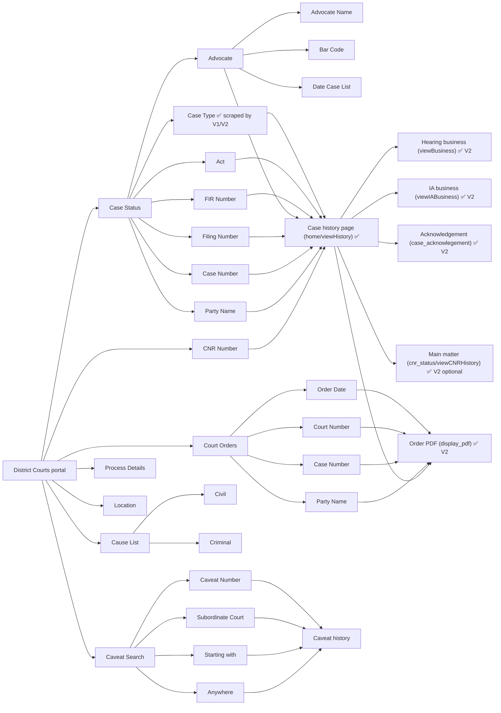

# eCourts District Courts Portal: Site Map

**Portal:** `https://services.ecourts.gov.in/ecourtindia_v6/` (eCourts Services, District and Taluka Courts)
**Mapped:** 2026-11-13, from the live site.
- Reads only: page GETs, the site's own JavaScript, and the dropdown-filling endpoints.
- No search was submitted and no CAPTCHA was solved.
- 25 pages, 22 JS files and 38 dropdown requests.
- Raw captures and the scripts that produced this map are in [`docs/ecourts_map/`](ecourts_map/).

**Evidence labels used below**

| Label | Meaning |
|---|---|
| **LIVE** | Seen on the live site: the page/form markup, or a dropdown endpoint actually called and answered. |
| **JS** | Read from the site's JavaScript: the endpoint and parameter names are exact, but the call was not made. |
| **SCRAPED** | Already exercised end-to-end by our scrapers (V1/V2) in live runs. |
| **UNVERIFIED** | The response shape is unknown until a real search is made. |

---

## 1. The map at a glance

**Current coverage.**
- **Search:** only *Case Status → Case Type* is automated, by both V1 and V2.
- **Detail pages:** everything reachable from a case's history page is captured by V2: business, IA, PDF, acknowledgement, and the main matter.
- **Not yet automated:** the other 6 Case Status tabs, plus Court Orders, Cause List, Caveat Search and CNR search.
- **Reusable as-is:** every option shares the same session handshake, court hierarchy and CAPTCHA, so all of that can be reused.

---

## 2. Shared mechanics (all options)

**Request protocol.** Every option uses the same protocol (**SCRAPED**):
- **Endpoint form:** all calls are `POST ?p=<endpoint>`, with a form body plus `ajax_req=true&app_token=<token>`.
- **Headers:** `X-Requested-With: XMLHttpRequest`, `delimeter: <D>` and `<H>: <D>`. D and H are read from `ajaxCall` in `js/components.js?v=…` and change between site versions.
- **Token rotation:** every JSON reply carries the next `app_token`.
- **Errors:** come back as `errormsg`.
- **Session start:** `GET ?p=casestatus/index` sets the cookie and the first token; then `GET components.js`.

**Court selector.** Every service except CNR and Process Details starts with the same 4-level selector (**LIVE**):

| Level | Field | Filled by | Value format | Notes |
|---|---|---|---|---|
| State | `sess_state_code` | static in the page (36 states) | numeric code, e.g. `3` = Karnataka | list in §9 |
| District | `sess_dist_code` | `casestatus/fillDistrict` {state_code} → `dist_list` | numeric, e.g. `20` = Bengaluru | |
| Court Complex | `court_complex_code` | `casestatus/fillcomplex` {state_code, dist_code} → `complex_list` | **`<complex>@<est,est,…>@<flag>`**, e.g. `1030134@2,5,10,11,12,13,14@Y` | flag `Y` means an establishment must also be chosen |
| Establishment | `court_est_code` | `casestatus/fillCourtEstablishment` {state_code, dist_code, court_complex_code} → `establishment_list` | numeric est code | required when flag = Y |

Selecting a complex or establishment calls `casestatus/set_data` {complex_code=`<complex>@<est>@<flag>`, selected_state_code, selected_dist_code, selected_est_code} and `villageSearch/set_state` {selected_state_code}. The search endpoints then also receive `state_code, dist_code, court_complex_code, est_code` in their body.

**CAPTCHA.** Opening any search tab calls `casestatus/getCaptcha`, which returns `div_captcha` holding a securimage ``. The code goes into the tab's own `*_captcha_code` field. One CAPTCHA is needed per search submission (**SCRAPED**: solved by OCR in V1/V2).

**Language.** `?p=home/fillLangState&lang=…&code=…` switches between English, हिन्दी, मराठी, ગુજરાતી, ಕನ್ನಡ and தமிழ் (**LIVE**). Option labels change; the parameters do not.

---

## 3. CNR Number (`?p=home/index`)

| Field | Name | Notes |
|---|---|---|
| CNR | `cino` | 16 characters, e.g. `KABC010342242022` |
| CAPTCHA | `fcaptcha_code` | |

- **Submit:** `cnr_status/searchByCNR/` {cino, fcaptcha_code} (**JS**). The reply is expected to be the case history page. **UNVERIFIED** (not submitted).
- **Related, no CAPTCHA:** `cnr_status/viewCNRHistory/` {cino} returns the full case history by CNR alone (**SCRAPED**: V2 uses it for linked main matters).
  - This makes it a direct route to any case whose CNR is known.

---

## 4. Case Status (`?p=casestatus/index`): 7 search tabs

Each tab sends its own form, plus `state_code, dist_code, court_complex_code, est_code`. Results are a table of cases; each row opens `viewHistory(...)` (§8).

| Tab | Endpoint | Form fields (name → meaning) | Dropdowns it needs | Status |
|---|---|---|---|---|
| **Party Name** | `casestatus/submitPartyName` | `petres_name` (petitioner/respondent, required), `rgyearP` (registration year, required), `case_status` = Pending / Disposed / Both, `fcaptcha_code` | — | JS |
| **Case Number** | `casestatus/submitCaseNo` | `case_type`, `search_case_no`, `rgyear`, `case_captcha_code` (+ `case_no`, `rgyear` re-sent) | case types: `fillCaseType` search_type=`c_no` | JS |
| **Filing Number** | `casestatus/submitFillingNo` | `case_type`, `filing_no`, `filyear`, `file_captcha_code` | case types (c_no) | JS |
| **Advocate** | `casestatus/submitAdvName` | `radAdvt` = 1 Advocate Name / 2 Bar Code / 3 Date Case List; `advocate_name`; `adv_bar_state`+`adv_bar_code`+`adv_bar_year`; `case_status` P/D/B; `caselist_date`; `adv_captcha_code` | — | JS |
| **FIR Number** | `casestatus/submitFirNo` | `police_st_code` (+`uniform_code`), `fir_no`, `firyear`, `case_status` P/D/B, `fir_captcha_code` | police stations: `casestatus/fillPoliceStation` | JS |
| **Act** | `casestatus/submitAct` | `search_act` (text filter), `actcode`, `under_sec`, `case_status` = Pending / Disposed (no Both), `act_captcha_code` | acts: `casestatus/fillActType` {…, search_act} | JS |
| **Case Type** | `casestatus/submit_case_type` | `case_type_1` (e.g. `23^3`), `search_year`, `case_status` = Pending / Disposed, `ct_captcha_code` | case types: `fillCaseType` search_type=`c_type` | **SCRAPED** (V1, V2) |

Sub-options worth noting:
- **Advocate** has 3 modes. *Advocate Name* is free text. *Bar Code* takes state + code + year. *Date Case List* takes a date and gives that advocate's list for the day.
- **Case Type** and **Act** offer only Pending / Disposed. Party Name, Advocate and FIR also offer *Both*.
- **Case type value format** is `<type>^<est>`, e.g. `23^3` = EX in establishment 3 (**LIVE**).

---

## 5. Court Orders (`?p=courtorder/index`): 4 search tabs

Every tab has an order-kind choice: Interim Orders (`interim`), Final Orders (`finalorder`) or Both (`both`). The body sends `court_complex` and `court_complex_arr` instead of `court_complex_code`. Results are expected to link to order PDFs through `displayPdf(...)` → `home/display_pdf` (**UNVERIFIED** until a search is made).

| Tab | Endpoint | Form fields | Dropdowns | Status |
|---|---|---|---|---|
| **Party Name** | `courtorder/submitPartyName` | `partynameOrder`, `rgyearOrder`, `frad`, `order_party_captcha_code` | — | JS |
| **Case Number** | `courtorder/submitCaseNo` | `case_type`, `case_no`, `rgyear`/`rgyearCaseOrder`, `radvalue` (= frad), `order_case_captcha_code` | case types (c_no) | JS |
| **Court Number** | `courtorder/submitCourtNo` | `nnjudgecode1` → sent as `nnjudgecode`, `temp_date1`, `temp_date2`, `court_code`, `orderflagvalcourtno`, `order_no_captcha_code` | `courtorder/fillCourtNumber` | JS |
| **Order Date** | `courtorder/submitOrderDate` | `from_date`, `to_date`, `orderflagvalorderdt`, `order_date_captcha_code` | — | JS |

- **Court Number value format** is `<court_code>$<judge_code>^<from yyyy-mm-dd>^<to yyyy-mm-dd>` (**LIVE**).
  - The list holds every judge posting in the court with its date range: 1,082 postings for City Civil Court est 3, back to 2000.
  - The site splits the value into `nnjudgecode` / `temp_date1` / `temp_date2` / `court_code`.
  - Entries whose value is `D` are group headings, not selectable.
- **Order Date** is the only route that lists orders by date range, regardless of party or case. It is the obvious bulk route for judgments.

---

## 6. Cause List (`?p=cause_list/index`)

| Field | Name | Notes |
|---|---|---|
| Court | `CL_court_no` | from `cause_list/fillCauseList`. Value format `<court_code>^<judge_code>`, e.g. `3^846`; `D` rows are group headings. 79 courts for est 3 (**LIVE**) |
| Date | `causelist_date` | |
| CAPTCHA | `cause_list_captcha_code` | |

- **Submit:** `cause_list/submitCauseList`, with extra fields `court_name_txt`, `cicri` and `selprevdays` (**JS**).
- **Civil / Criminal:** two buttons, `submit_causelist('civ')` and `submit_causelist('cri')`, set `cicri`.
- **Result:** the day's list of cases for that court. Each row is expected to link to case history. **UNVERIFIED**.
- **Use:** the source for *upcoming / pending* hearings, which a Disposed case search will not show.

---

## 7. Caveat Search (`?p=caveat_search/index`): 4 modes

| Mode (`searchcaveat`) | Fields |
|---|---|
| `anywhere` | `caveatorname` (required), `caveateename` |
| `startingwith` | `caveatorcaveatee`, with `rcaveator` = 1 Caveator / 2 Caveatee |
| `subordinateCourt` | `subordinate_court_name` (from `caveat_search/fillSubordinateCourt`, 77 courts for est 3), `filing_type` = 2 Case Number / 1 Filing Number, `case_type_caveat` (from `fillCaseType` search_type=`caveat_search`), `caveat_search_case_no` or `caveat_filing_no`, `caveat_rgyear`, `caveat_dateofdecision_date` |
| `caveatno` | `caveat_no`, `caveat_year` |

- **Common:** `caveat_captcha_code`, plus the hidden selector state.
- **Submit:** `caveat_search/submitCaveat` (**JS**).
- **Detail:** result rows open `viewBusinessCaveat(...)` → `home/caveat_search_case_history` {caveat_no, caveat_disp_no, court_code, search_flag, state_code, dist_code, court_complex_code} (**JS**, **UNVERIFIED**).

---

## 8. Detail pages behind a case (reached from search results)

| From | Endpoint | Parameters (from the site JS) | Status |
|---|---|---|---|
| result row → case history | `home/viewHistory` | court_code, state_code, dist_code, court_complex_code, case_no, cino, hideparty, search_flag, search_by | **SCRAPED** V1/V2 |
| hearing row → daily business | `home/viewBusiness` | court_code, state_code, dist_code, court_complex_code, nextdate1, case_number1, disposal_flag, businessDate, national_court_code, court_no, search_by, srno | **SCRAPED** V2 |
| IA row → IA business | `home/viewIABusiness` | state_code, dist_code, court_complex_code, ia_no, cinoia, ia_case_type_name, ia_filno, ia_filyear, national_court_code, search_by | **SCRAPED** V2 |
| order link → PDF | `home/display_pdf`, then GET `reports/<hash>.pdf` | normal_v, case_val, court_code, filename, appFlag (session-bound tokens) | **SCRAPED** V2 |
| QR / cause title → acknowledgement | `home/case_acknowlegement&cino=…&state_code=…&dist_code=…&court_code=…&court_complex_code=…&national_court_code=…` | (in URL) | **SCRAPED** V2 |
| main-matter CNR link | `cnr_status/viewCNRHistory/` | cino | **SCRAPED** V2 (`--follow-main-matters`) |
| status check | `cnr_status/checkStatus` | case_no, filename, case_val | JS, purpose unclear |
| caveat row | `home/caveat_search_case_history` | see §7 | JS |

---

## 9. Other services

| Service | Page | What it does | Endpoints | Scraping relevance |
|---|---|---|---|---|
| **Process Details** | `?p=processDetails/processData` | Look up a court process (summons/notice) by **Process ID** (e.g. `PKABC010342242022_1_1`, which V1/V2 already store) plus your email and a CAPTCHA | `processDetails/showProcess` {process_id, femail_id, fcaptcha_code}; then an OTP flow: `sendotp`, `verify_otp`, `authendicateData`, `closefile` | **Needs an email/mobile OTP.** Not suitable for unattended scraping. |
| **Location** | `?p=location/index` | Map location of a court complex | `location/location_details` {state_code, dist_code, court_complex_code} → `result` = "lon~lat", which opens a Bhuvan map | **LIVE**: City Civil Court replied "Latitude or Longitude is awaited". Low value. |
| **High Courts** | `?p=high_court/index` | Links out to the separate High Court services portal | — | Out of scope (different portal) |
| Information pages | about_us, news_letter, forms_for_advocates, help_videos, site_map, contact_us, policies, accessibility | Static content | — | None |
| Village search | `?p=villageSearch/index` | HTTP 400 when opened directly; only `villageSearch/set_state` is called, from the selector | — | None found |

The header also links to external sites: e-Committee, the Supreme Court, District Courts (ecourts.gov.in) and NJDG (njdg.ecourts.gov.in, national pendency statistics).

---

## 10. Hierarchy reference

**States (36; value in brackets):**
- Andaman and Nicobar (28), Andhra Pradesh (2), Arunachal Pradesh (36), Assam (6), Bihar (8), Chandigarh (27)
- Chhattisgarh (18), Delhi (26), Goa (30), Gujarat (17), Haryana (14), Himachal Pradesh (5)
- Jammu and Kashmir (12), Jharkhand (7), **Karnataka (3)**, Kerala (4), Ladakh (33), Lakshadweep (37)
- Madhya Pradesh (23), Maharashtra (1), Manipur (25), Meghalaya (21), Mizoram (19), Nagaland (34)
- Odisha (11), Puducherry (35), Punjab (22), Rajasthan (9), Sikkim (24), Tamil Nadu (10)
- Telangana (29), The Dadra And Nagar Haveli And Daman And Diu (38), Tripura (20), Uttarakhand (15), Uttar Pradesh (13), West Bengal (16)

**Karnataka districts (31):**
- Bagalkot (2), Ballari (12), Belagavi (1), **Bengaluru (20)**, Bengaluru Rural (21), Bidar (5), Chamrajnagar (27), Chikkaballapur (29)
- Chikkamagaluru (17), Chitradurga (13), Dakshina Kannada (24), Davangere (14), Dharwad (9), Gadag (8), Hassan (23), Haveri (11)
- Kalaburagi (4), Kodagu (25), Kolar (19), Koppal (7), Mandya (22), Mysuru (26), Raichur (6), Ramanagara (28)
- Shivamogga (15), Tumakuru (18), Udupi (16), Uttara Kannada (10), Vijayanagar (31), Vijayapura (3), Yadgir (30)

### Full worked example: Karnataka → Bengaluru (all LIVE)

| Complex (value) | Establishment (code) | Case types (count: list) |
|---|---|---|
| **CMM Court Complex** `1030134@2,5,10,11,12,13,14@Y` | Chief Metropolitan Magistrate Court (2) | 9: C.C., Cr, CRL.A, CRL.M.A., Crl.Misc., CRL.R.P., P.C.R., RC(A), RC(E) |
| | Special Court for Economic Offences (5) | 4: C.C., Cr, Crl.Misc., P.C.R. |
| | Metropolitan Magistrate Traffic Courts II–V (10, 11, 12, 13) | 4 each: C.C., Cr, Crl.Misc., P.C.R. |
| | Metropolitan Magistrate Traffic Court VI (14) | 5: C.C., Cr, CRL.A, Crl.Misc., P.C.R. |
| **City Civil Court Complex** `1030135@3@Y` | **Prl. City Civil and Sessions Judge (3)**. This is the court V1/V2 scrape. | 41: AA, A.C., A.P., A.S., C.C., Com.A.A., Com.A.P., Com.A.S., Com.EX., Com.FDP, Com.I.C., Com.M.A, Com.Misc., Com.O.S., COM.REV, Cr, CRL.A, Crl.Misc., CRL.R.P., ELEC.C, **EX (`23^3`)**, FDP, G and WC, I.C., L.A.C., LAC, M.A., MA, M.C., Misc, M.V.C., O.S., P and SC, P.C.R., P.MIS., R.A., R.C.-E, REV, Review Petition, SC, SPL.C |
| **NyayaDegula Court Complex** `1030136@15,16,17,18,19,20,21,23@Y` | Prl. Judge Family Court (15) | 12: Crl.Misc., E.P., Ex.C, FDP, G and WC, G and W.C., M.C., Misc, O.S., P.Misc., RA, REV |
| | Prl. Judge Vacation Family Court (16) | 11: same as 15, without REV |
| | Labour Court: Presiding Officer (17), II Addl. (18), III Addl. (19), I Addl. (23) | 8 each: APPL, CA, ID, MA, MDA, PA, REF, SLA |
| | Industrial Tribunal (20) | 14: COMP, Crl. Misc., ESI, ESI APP, ESI Misc.Appl, ESI Review Petition, Ex., ID, ID.Misc.Appl, MISC. Appl., P.W.A., SLA, S.O.A., T.U.A. |
| | Addl. Industrial Tribunal (21) | 8: A.I.D, AID.Misc.Appl, COMP, ESI, ESI App, ESI Misc.Appl, ESI Review Petition, S.L.A |
| **Small Causes Court Complex** `1030137@1@Y` | Chief Judge, Court of Small Causes (1) | 12: A.I.R.MISC, C.C, Cr, Crl.Misc., ECA, EX, H.R.C., MISC, M.V.C., P.C.R., REV, S.C. |
| **Mayo Hall Court Complex** `1030138@6,7,8,9@Y` | Addl. Small Causes Court Judges (6) | 38 (civil, criminal and rent types) |
| | Addl. City Civil and Sessions Judges (7) | 23 |
| | Addl. Chief Metropolitan Magistrates (8) | 5: C.C., Cr, Crl.Misc., J.C., P.C.R. |
| | Metropolitan Magistrate Traffic Court I (9) | 5: C.C., Cr, Crl.Misc., P.C.R., SC |
| **Commercial Court Complex** `1030210@22@Y` | Commercial Court (22) | 11: Com.A.A., Com.A.P., Com.A.S., Com.EX., Com.FDP, Com.I.C., Com.M.A, Com.Misc., Com.O.S., COM.REV, Crl.Misc. |

So Bengaluru alone has 6 complexes, 22 establishments and 246 establishment-level case-type options. Each option is one Case Type search, repeated per year and per status.

**Per-establishment dropdown sizes for City Civil Court est 3 (LIVE):**

| Dropdown | Size |
|---|---|
| Police stations | 2,945. The list is set **per court complex**: all of a complex's establishments share it, but complexes differ (Bengaluru: 2,054–3,064 per complex). It includes police stations far outside the district; value `<code>-<uniform_code>`. |
| Acts | 406 |
| Court numbers (judge postings since 2000) | 1,082 |
| Cause-list courts | 79 |
| Subordinate courts (caveat) | 77 |
| Case types | 41 |

The exact option lists are saved in `docs/ecourts_map/raw/enum/`. Every establishment in Bengaluru and Karnataka is covered in [`ECOURTS_KARNATAKA_MAP.md`](ECOURTS_KARNATAKA_MAP.md).

**Observed rules** (from all 22 Bengaluru establishments):
- Only **case types** vary per establishment.
- The Case Number (`c_no`), Case Type (`c_type`) and Caveat case-type lists are identical.
- Acts, police stations, judge postings, cause-list courts and subordinate courts are set **per court complex**: identical for every establishment in a complex, different between complexes.

---

## 11. Expansion notes (for future scraper work, not implemented)

| Goal | Best route | What can be reused from V2 | New work |
|---|---|---|---|
| More case types / years / courts | Case Status → Case Type, looped over the hierarchy (§10) | All of it, since only the search parameters change | A hierarchy enumerator. Full national enumeration is thousands of requests and must be paced. |
| Pending cases | Case Type with `case_status=Pending`, or Cause List by date | All of it | Parser for pending-only fields (next date, stage): synthetic tests exist, no real sample yet |
| Look up a known case | `cnr_status/viewCNRHistory/` {cino}, **no CAPTCHA** | Detail fetchers | CNR input list |
| Orders in bulk | Court Orders → Order Date (date range) | PDF download and text extraction | Parse the order-search result table (UNVERIFIED shape) |
| One person's cases | Case Status → Party Name / Advocate | Detail fetchers | Result-table parser (expected to match the Case Type table) |
| Criminal cases by FIR | Case Status → FIR Number | Detail fetchers | Police-station list (per court complex), FIR sections in the case page |
| Caveats | Caveat Search (4 modes) | Session, CAPTCHA | New result and detail parsers |

**Before building any of these:** each UNVERIFIED result format needs one real search to capture a fixture, as was done for Case Type. The firewall limits found during the V2 tests apply to every option: block at about 2 requests per second or more, safe at about 1.4.
